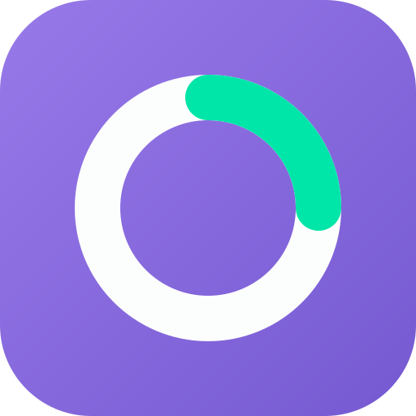
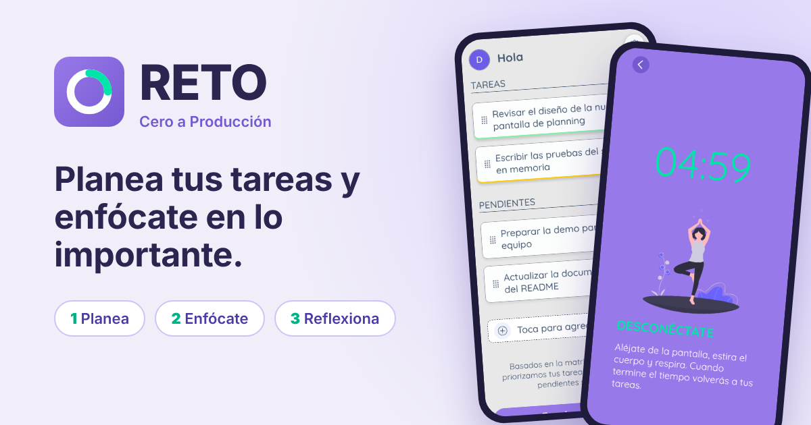
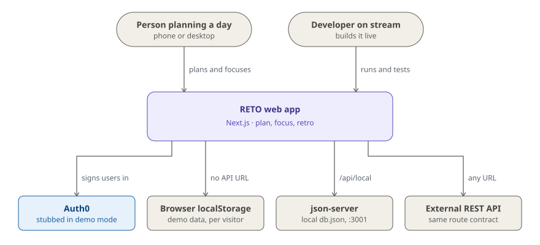

# RETO · Cero a Producción

**Plan your day, cap what's in progress at 2 tasks, and focus with a timer that offers a break after every win.**

[](https://github.com/glrodasz/cero-web/actions/workflows/release.yml) [](https://app.codecov.io/gh/glrodasz/cero-web) [](LICENSE) [](https://nextjs.org) [](https://react.dev) [](.nvmrc)

<br clear="left">

[**Live demo**](https://prior.guillermorodas.com/) · [How it works](#how-it-works) · [Architecture](#architecture) · [Quick start](#quick-start) · [Deployment](docs/deployment.md)



## Why

Long to-do lists don't get done; they get re-read. RETO keeps the list short on
purpose: a couple of tasks in progress, a small backlog behind them, and a focus
session that celebrates each completed task with a break instead of pushing you
straight into the next one. It ends with a short retrospective, so the day
closes with what went well and what got in the way.

It is built for people who plan their work in small, focused blocks, on a phone
or a desktop. It is not a project tracker: there are no projects, assignees or
due dates.

**RETO** is the app built live in **Cero a Producción**, a series of live coding
sessions that take it from scratch to production — real decisions, failing
tests, refactors and all. 📺 [YouTube](https://glrz.me/youtube-cero) ·
🟣 [Twitch](https://glrz.me/stream) (live in 🇪🇸 Spanish, Tuesdays to Fridays).
Part of the [Cero a Producción project](https://github.com/glrodasz/cero).

### Design principles

| Principle | In practice |
| --- | --- |
| Fewer tasks, finished | In progress and backlog are capped (2 and 4 by default, `NEXT_PUBLIC_MAXIMUM_*`). |
| Celebrate every small win | Completing a task during a session **always** offers a 5, 10 or 15 minute break. |
| A break is a real pause | Taking one stops the session's clock until you resume, even across a reload. |
| Close the loop | A session ends in a retrospective: time focused, tasks completed, mood and blockers. |
| Nothing to provision for a demo | With no API URL, each visitor's data lives in their own browser. |

## Quick start

Prerequisites: **Node 24** (`.nvmrc`) and **Yarn 4** through Corepack.

```bash
git clone https://github.com/glrodasz/cero-web.git
cd cero-web
corepack enable
yarn
cp db.seed.json db.json
NEXT_PUBLIC_DEMO_MODE=true yarn dev
```

Open <http://localhost:3000/planning>. `yarn dev` starts:

| What | Where |
| --- | --- |
| The web app | `http://localhost:3000` |
| This app's API routes | `http://localhost:3000/api/local` |
| `json-server` over `db.json` | `http://localhost:3001` |

`NEXT_PUBLIC_DEMO_MODE=true` signs you in as a demo user. To sign in with Auth0
instead, copy `.env.local.example` to `.env.local`, fill in `AUTH0_SECRET` and
`AUTH0_CLIENT_SECRET`, and run plain `yarn dev`.

<details>
<summary>Reproduce the public demo locally (data in your browser, no json-server)</summary>

```bash
NEXT_PUBLIC_DEMO_MODE=true yarn build
NEXT_PUBLIC_DEMO_MODE=true yarn start
```

`.env.production` leaves `NEXT_PUBLIC_API_URL` unset, so every request is
answered inside the browser and stored in `localStorage`.

</details>

## How it works

A day in RETO has three screens, and each one leads to the next.

| Screen | Route | What happens |
| --- | --- | --- |
| **Planning** | `/planning` | Add tasks, drag them between *Tareas* (in progress) and *Pendientes* (backlog), open one for its duration, subtasks and notes. "Empieza ahora" starts a focus session. |
| **Focus session** | `/focus-session` | A chronometer runs while you work. Checking off a task offers a 5, 10 or 15 minute break, which pauses the clock; a paused session shows a "Reanudar" banner until you resume. |
| **Retrospective** | `/retrospective` | A recap (time focused, tasks completed in this session), then how you felt — *Frustrado*, *Normal* or *Muy motivado* — and optional blockers. Choosing a mood registers the session; you can also skip it or go back to the session. |

The app redirects between planning and an active focus session on its own, so
reopening it lands you where you left off. It is installable as a PWA, opening
straight into `/planning` without browser chrome.

Every task detail field saves on its own, optimistically, and rolls back if the
write fails. Task and focus-session rules — completing, starting, pausing,
finishing — run in `features/*/commands.js`, so they behave the same whichever
store sits behind them.

## Architecture

<picture>
  <source media="(prefers-color-scheme: dark)" srcset="docs/diagrams/context-dark.svg">
  
</picture>

RETO is one Next.js app. Auth0 signs users in, except in demo mode, where a stub
user stands in and no secret is needed.

**One variable picks the backend: `NEXT_PUBLIC_API_URL`.** Unset, the browser
answers its own requests and stores data in `localStorage` (the public demo).
`/api/local` sends them to this app's API routes, backed by `json-server` (local
development); `/api/test` does the same over committed fixtures (integration
tests). Any other URL is an external backend that implements the same REST
contract. The value is baked in at build time.

Server rendering never calls the app's own API over HTTP: `getServerSideProps`
reads the store directly through `features/*/queries.js`. The full request path,
the data-layer rules and the incidents that shaped them are in
[`docs/ARCHITECTURE.md`](docs/ARCHITECTURE.md).

**Tech stack** — UI: React 18, [`@glrodasz/components`](https://github.com/glrodasz/cero-components), `react-beautiful-dnd` ·
Data: `@tanstack/react-query` v4 · App: Next.js 15 (pages router), `@auth0/nextjs-auth0` ·
Storage: `localStorage`, `json-server` · Tooling: Yarn 4, Jest, Testing Library, TestCafe, ESLint, Prettier, Husky.

## Usage and configuration

| Variable | Purpose |
| --- | --- |
| `NEXT_PUBLIC_API_URL` | Backend selector: unset, `/api/local`, `/api/test` or a backend URL. |
| `NEXT_PUBLIC_DEMO_MODE` | `true` stubs Auth0 with a demo user. |
| `NEXT_PUBLIC_MAXIMUM_IN_PRIORITY_TASKS` | In-progress cap (`2` in every committed env file). |
| `NEXT_PUBLIC_MAXIMUM_BACKLOG_QUANTITY` | Backlog cap (`4`). |
| `JSON_SERVER_URL` | Where `json-server` listens, read only behind `/api/local`. |
| `AUTH0_SECRET`, `AUTH0_CLIENT_SECRET` | Auth0 secrets, in `.env.local`. |

`NEXT_PUBLIC_*` values compile into the bundle: change one, then rebuild. Hosting
setup and the demo's behaviour are in [`docs/deployment.md`](docs/deployment.md).

| Command | What it does |
| --- | --- |
| `yarn dev` | `json-server` on :3001 and Next on :3000 |
| `yarn build` / `yarn start` | Production build and server |
| `yarn test` | Jest unit and component tests |
| `yarn test:integration` | TestCafe in Chrome against the fixtures, no `json-server` |
| `yarn lint` | ESLint, Prettier and Stylelint |
| `yarn commit` | Commitizen prompt for a Conventional Commit |

### Project layout

```
api/            HTTP client classes and the in-browser transport
config/         Env reads, incl. dataSource.js (the backend selector)
datasources/    Stores: localStorage/, fixtures/, jsonServer.js, shared collections/
features/       common, tasks, planning, focusSession, retrospective
pages/          Next routes; pages/api/[source]/** serves every namespace
public/         PWA manifest, icons, OG image
tests/          TestCafe integration tests
utils/          Generic helpers, never importing from features/
```

## Documentation

| Doc | What's in it |
| --- | --- |
| [`docs/ARCHITECTURE.md`](docs/ARCHITECTURE.md) | Request path from hook to store, data-layer rules |
| [`docs/deployment.md`](docs/deployment.md) | Deploying, the browser-backed demo, environment variables |
| [`AGENTS.md`](AGENTS.md) | Conventions: feature layout, handlers, hooks, tests, rules from production incidents |
| [`cero-components`](https://github.com/glrodasz/cero-components) | The UI kit ([Storybook](https://cero-components.vercel.app), [npm](https://www.npmjs.com/package/@glrodasz/components)) |
| [`cero-api`](https://github.com/glrodasz/cero-api) | Backend explorations across several stacks |

## Contributing

Work happens live on stream; changes follow the same conventions.

- **A feature** goes in `features/<feature>/`: components, containers, `use*`
  hooks, `create*Handler` factories in `handlers.js`, pure logic in
  `helpers.js`. Data goes through `features/common/api`.
- **A rule behind an API route** goes in that feature's `commands.js`, with a
  thin route in `pages/api/[source]/**` and a matching entry in
  `api/browserTransport.js` (a test fails if they diverge).
- **Tests** sit next to the code (`Thing.test.js`), Arrange / Act / Assert.

Before pushing, run `yarn lint` and `yarn test`. CI runs lint, tests, the build
and coverage on every pull request to `main`. Commits follow
[Conventional Commits](https://www.conventionalcommits.org), enforced by
commitlint; Husky formats staged files on commit. Full conventions are in
[`AGENTS.md`](AGENTS.md).

## License

[MIT](LICENSE) © 2026 Guillermo Rodas.
