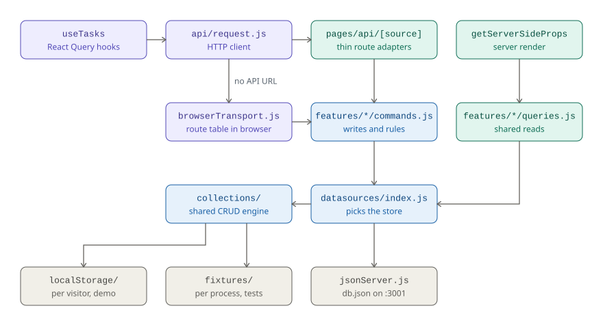

# Architecture

RETO is a single Next.js app (pages router). The system context is in the
[README](../README.md#architecture); this page follows a request from a React
hook down to the store that answers it.

## How a request reaches a store

<picture>
  <source media="(prefers-color-scheme: dark)" srcset="diagrams/request-path-dark.svg">
  
</picture>

Purple runs in the browser, green on the server, blue in both, and gray is
storage.

| Step | File | Role |
| --- | --- | --- |
| 1 | `features/*/hooks/use*.js` | React Query hooks; mutations invalidate their query key |
| 2 | `api/request.js` | Builds the URL from `API_URL`, checks `response.ok`, throws errors that carry the status |
| 3a | `pages/api/[source]/**` | Thin HTTP adapters, wrapped in `withApiRoute` (400 for a wrong namespace, 405 for an unanswered method) |
| 3b | `api/browserTransport.js` | With no API URL: a route table mirroring the route files, answered in the browser |
| 4 | `features/*/commands.js` | The rules (complete, start, pause, finish…) as `{ status, body }` |
| 4′ | `features/*/queries.js` | Named reads shared by `getServerSideProps` and the routes |
| 5 | `datasources/index.js` | Picks the store derived from `NEXT_PUBLIC_API_URL` |
| 6 | `datasources/collections/` | The one CRUD and query engine, over `localStorage/` and `fixtures/` |

## Rules the layout protects

- **One selector.** `config/dataSource.js` derives both the browser's API URL
  and the server's store from `NEXT_PUBLIC_API_URL`, so they cannot disagree.
  An unknown `/api/<namespace>` or the retired `NEXT_PUBLIC_DATA_SOURCE` fails
  the build.
- **Route logic lives in commands.** The API routes and the browser transport
  are both adapters over the same commands, so the browser demo behaves exactly
  like the routes. `api/browserTransport.test.js` walks `pages/api/[source]/**`
  and fails if a route has no matching entry.
- **No self-fetch.** `getServerSideProps` reads through `queries.js` instead of
  calling the deployment's own routes over HTTP, which Vercel Deployment
  Protection rejects with a 401.
- **CRUD is defined once.** `collections/` serves both the browser demo store
  and the test fixtures; a new store supplies `getCollections` and
  `saveCollections` and nothing else.
- **`local-storage` is browser-only.** Its store throws when reached from the
  server, and the routes answer 404 for it, so a misplaced read fails loudly.
- **Writes are serialized per JavaScript context.** `collections/lock.js`
  queues a session's writes, so parallel reorders don't drop one. Two browser
  tabs writing at the same moment can still lose a write; the next one
  corrects it.

Environment wiring and hosting are in [`deployment.md`](deployment.md); the
full conventions are in [`AGENTS.md`](../AGENTS.md).
